<picture>
  <source media="(prefers-color-scheme: dark)" srcset="assets/header-dark.svg">
  
</picture>

I build backends that stay up: services that split cleanly, queues that don't lose messages, and the monitoring that tells you when something stops breathing.

<samp>Java · Spring Boot · PHP · Laravel · TypeScript · PostgreSQL · Kafka · Docker</samp>

 

**[opencheck](https://github.com/elkhelyfy/opencheck)** Uptime monitoring, built on Laravel 13, React and Inertia.

**[event-microservice](https://github.com/elkhelyfy/event-microservice)** Event booking split into six Spring Boot services: a JWT gateway, Eureka discovery, seat reservations with a waitlist, and notifications over Kafka.

**[ECG](https://github.com/elkhelyfy/ECG)** *Onde par Onde*, an interactive way to learn to read an electrocardiogram: the machine, a reading method, an atlas of traces and practice. Plain JavaScript.

**[the_girlies_club](https://github.com/elkhelyfy/the_girlies_club)** Website for The Girlies Club, crochet, painting and embroidery workshops for women in Casablanca. Astro on Netlify.

**[portfolio](https://github.com/elkhelyfy/portfolio)** My portfolio, a static Astro site with an IBM punched card for a hero.

 

<samp>[email](mailto:khelyfy.mohammed@gmail.com) · [linkedin](https://www.linkedin.com/in/mohammed-el-khelyfy)</samp>
