I build backends that stay up: services that split cleanly, queues that don't lose messages, and the monitoring that tells you when something stops breathing. Usually at night, usually with coffee.

 

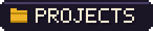

<table>
  <tr>
    <td width="72" align="center"></td>
    <td><a href="https://github.com/elkhelyfy/opencheck"><b>opencheck</b></a> Uptime monitoring, built on Laravel 13, React and Inertia.</td>
  </tr>
  <tr>
    <td align="center"></td>
    <td><a href="https://github.com/elkhelyfy/event-microservice"><b>event-microservice</b></a> Event booking split into six Spring Boot services: a JWT gateway, Eureka discovery, seat reservations with a waitlist, and notifications over Kafka.</td>
  </tr>
  <tr>
    <td align="center"></td>
    <td><a href="https://github.com/elkhelyfy/ECG"><b>ECG</b></a> <i>Onde par Onde</i>, an interactive way to learn to read an electrocardiogram: the machine, a reading method, an atlas of traces and practice.</td>
  </tr>
  <tr>
    <td align="center"></td>
    <td><a href="https://github.com/elkhelyfy/the_girlies_club"><b>the_girlies_club</b></a> Website for The Girlies Club, crochet, painting and embroidery workshops for women in Casablanca. Astro on Netlify.</td>
  </tr>
  <tr>
    <td align="center"></td>
    <td><a href="https://github.com/elkhelyfy/portfolio"><b>portfolio</b></a> My portfolio, a static Astro site with an IBM punched card for a hero.</td>
  </tr>
</table>

 

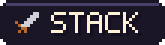

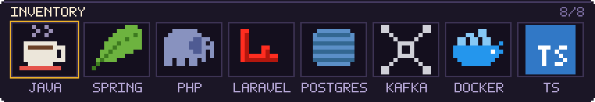

 

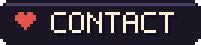

<a href="mailto:khelyfy.mohammed@gmail.com">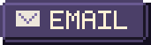</a>&nbsp;&nbsp;<a href="https://www.linkedin.com/in/mohammed-el-khelyfy">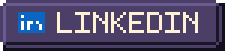</a>

 

