IBM 029 card code · the holes spell my name

## Backends where every cent has to reconcile

I'm Mohammed, a backend engineer in Casablanca. Since December 2022 I've been building fund-accounting software for investment firms in Luxembourg: PHP every day (Laminas, Laravel, Symfony), Java and Spring Boot where they fit, and AI features shipped inside real business software rather than as chatbots.

**Open to backend and cloud roles** in Casablanca, Rabat or remote. [khelyfy.mohammed@gmail.com](mailto:khelyfy.mohammed@gmail.com)

### Selected work

| Project | What it is | Stack |
| :-- | :-- | :-- |
| **E-LMA** | Portfolio management and fund accounting with a 450+ entity data model. Moved it from Zend to Laminas and PHP 5 to 8 without taking it offline. | PHP&nbsp;8&nbsp;· Laminas&nbsp;· MySQL |
| **IGODAR** | A fund-administration platform started from an empty repo by a team of three. Exact money maths in bcmath, and an assistant that turns questions into read-only SQL. | Laravel&nbsp;· Pest&nbsp;· LLMs |
| **E-LMA CoSec** | Company secretariat for whole groups. Synced with the Moroccan courts' API, with litigation files summarised by an LLM. | Laminas&nbsp;· MySQL&nbsp;· OpenAI |
| **Marechal** | A RAG platform that answers from your own documents and cites them. Hybrid search, OCR, row-level security, 319 tests. | FastAPI&nbsp;· Qdrant&nbsp;· Redis |
| **[Event Platform](https://github.com/elkhelyfy/event-microservice)** | Event booking on six Spring Boot services behind a gateway, talking over Kafka, with a waitlist when events sell out. | Spring Cloud&nbsp;· Kafka |
| **[opencheck](https://github.com/elkhelyfy/opencheck)** | Uptime monitoring. | TypeScript&nbsp;· PHP |

The first three are client work at Winfox Service, so their code is private.

 

 

[Email](mailto:khelyfy.mohammed@gmail.com) · [LinkedIn](https://www.linkedin.com/in/mohammed-el-khelyfy) · [Portfolio source](https://github.com/elkhelyfy/portfolio) · Arabic, French, English
